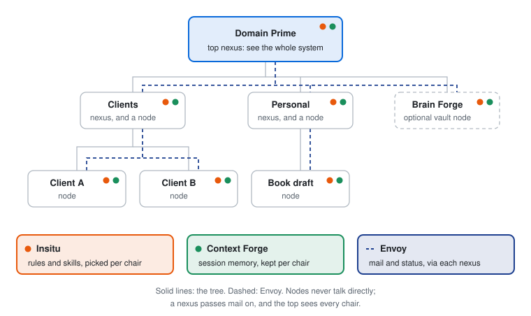

# Domain Prime

Domain Prime organizes your AI projects as a tree: one install gives every project its own rules, its own memory, and a way to reach the others, in every AI client you use, all running on your machine.

<picture>
  <source media="(prefers-color-scheme: dark)" srcset="docs/system-dark.svg">
  
</picture>

## Why this exists

Once you run more than a few projects with AI, they turn into a pile. The same instructions get pasted into every repo and drift apart. Each new session starts from zero because yesterday's sitting is gone. Details from one client end up in another client's chat. And nothing tells you, in one place, what all of it is waiting on.

Domain Prime turns the pile into a tree. Projects are grouped into lines of work. Every project is sovereign: its own rules, its own memory, its own walls. Four engines give each one what it needs, and give you one view from the top.

## The five parts

| Part | The question it answers | What it gives you |
|---|---|---|
| **Domain Prime** (this repo) | Where does everything live? | The tree: one top folder, a registry of lines of work and projects, and an install that wires every engine to it. |
| **[Insitu](https://github.com/srmackey/insitu)** | How should I work here? | Write your instructions once. Every project subscribes to exactly the set it needs. |
| **[Context Forge](https://github.com/srmackey/context-forge)** | What happened last time? | Every session picks up where the last one left off, in any AI client. |
| **[Envoy](https://github.com/srmackey/envoy)** | What matters most, and who needs to know? | Projects can't see into each other, so Envoy carries the messages between them and keeps one ranked board of priorities. Step in at the top to see everything that needs you. |
| **[Brain Forge](https://github.com/srmackey/brain-forge)** | What do I know? | An optional knowledge vault your agents keep tidy: captured, synthesized, graphed. |

Each engine also runs on its own. Domain Prime is what makes them one system.

## A week with Domain Prime

A consultant with two clients and a book in progress. Every name here is made up.

**Monday: set up the tree.** One command builds the top folder, the shelf of instruction packs, and the server config that starts Insitu, Envoy, and Context Forge. From the top, the agent adds two lines of work, Clients and Personal, then three projects: Client A and Client B under Clients, Book draft under Personal. Each one gets its own constitution, the file that says what it is for and how to work there. Client B handles confidential material, so the registry marks it sensitive.

**Tuesday: work in a project.** The first session in Client A asks what it should subscribe to. It takes the shared code-review guidance and the writing style, and nothing from the book. Insitu writes that set into the files the AI client already loads. At the end of the session, Context Forge keeps a record of the sitting. Wednesday's session opens with it, even if you've switched AI clients.

**Wednesday: keep the walls.** Working in Client A, the agent notices something Client B should know. It doesn't open Client B. It sends a note through the Clients line of work. Because Client B is sensitive, the note stops at a gate: you deliver it, hold it, or discard it. Client B can also be set to publish thinner status reports, and the dashboard keeps its content hidden until you choose to show it.

**Thursday: change a rule once.** You tighten the code-review guidance in Insitu once. Every project that subscribes to it picks up the change the next time it rematerializes. A project can't quietly rewrite a shared rule from the inside.

**Friday: step in at the top.** Envoy's dashboard shows every chair's health, what needs you, and one ranked priority board for the week. When you step into Book draft from the top, the agent loads that project's constitution and works under its rules, not the top's. A weekly pass reconciles the board and clears the desk, so context doesn't pile up into next week.

## Works with the AI clients you use

You name your AI clients once, in `platforms.yaml` at the top of the tree. The install registers the servers with each one. Insitu then writes every project's rules and skills into the files each client already loads: one project, one set of rules, delivered to every client in that client's own format. Context Forge memory is shared across all of them, so a sitting in one client is there for the next session in another.

Routers for Claude, Cursor, and Grok ship today. The list is open: add a client by giving it a definition in the same file, and nothing else changes. Drop one, and its files are removed cleanly while the others stay.

## Who it's for

- **The consultant.** Several clients, each kept apart, with one board across all of them.
- **The multi-repo developer.** Ten repos share a house style; only the backend repos load the API-review skill.
- **The writer or researcher.** Projects that aren't code at all: a book, a literature review, a household admin folder.
- **The team of agents.** Several always-on agents, each in its own project, coordinating through mail instead of a shared scratchpad.

## Principles

- **Local-first.** Everything runs on your machine. The servers talk to your AI client over stdio, make no network calls, and take no credentials.
- **Files are the record.** Markdown and YAML on disk. Indexes are derived and rebuildable.
- **Sovereign projects.** Each project's constitution stops at its edge. A nexus holds awareness, not work.
- **Your rules win where you step in.** Working inside a project means working under its rules. Across projects, the stricter privacy rule wins.
- **Any AI client.** Name the clients you use; every project adapts to each one.
- **Each engine stands alone.** Install the whole tree, or use one engine in one folder.

The system has a small vocabulary: nexus, node, chair, sitting, sitrep. The [glossary](docs/glossary.md) defines each one in plain words.

## Install

This repo is the installable tree: a seed, an empty registry, and the engines a release pins.

A person clones this repo and runs its install. They get one top folder and one shelf. The top folder is one nexus with an empty roster.

Run this from a clone of the repo:

```
python install.py <top-folder>
```

The last part of `<top-folder>` is the nexus name. Use lowercase letters, digits, and hyphens, as in `garden`. The command writes `nexus.md` in that folder and creates `shelf/` beside it. The shelf is where Insitu keeps the packs for that tree. It holds the capability pack and the roles `domainprime`, `nexus`, and `node`. The top nexus wears `domainprime` only.

The same command clones the three engines in the pin table into `engines/` at those tags and harvests each `provisions/pack.yaml` onto the shelf. It writes `.mcp.json` at the top folder. A session opened there starts Insitu, Envoy, and Context Forge against that folder and that shelf. The file does not edit a user-level host config, and the install does not write `platforms.yaml`.

After Insitu is harvested, the new tree's `_global` map imports `methodology/product-provisions` from `insitu-core`. The article stays in the Insitu repository.

Brain Forge stays out unless the install asks for it:

```
python install.py <top-folder> --with-brain-forge
```

That creates `vault/` at the install root and adds `library: vault` plus a node row. The folder is the library. Brain Forge's framework is copied into it, and the pin is not kept beside the servers. The same pass harvests Brain Forge's public contract and copies the theme pack `domainprime-theme` onto the shelf: the vault door and the discreet mail pair. No map composes that pack. `.mcp.json` does not gain a server.

The same flag on a folder that is already installed adds the library, the row, and the theme pack. It leaves the maps and the other engines as they are.

Refresh the shelf from a newer copy of this repo:

```
python install.py <top-folder> --update
```

The refresh replaces the generated pack, roles, articles, and skills, and harvests the engines again. It leaves `nexus.md` and the project maps as they are, apart from adding the `methodology/product-provisions` import when that import is missing. If `vault/` is already there, the refresh harvests Brain Forge again, recopies the theme pack, and replaces the framework inside `vault/_brain-forge/`. Notes, seeded primers, and the registry row stay. To add the library during a refresh, pass `--with-brain-forge` as well. If a clone fails, run the same command again with `--update`, and with `--with-brain-forge` when that choice was part of the install.

## Pins

| Pin | Repository | Version | When |
|---|---|---|---|
| Insitu | https://github.com/srmackey/insitu | v0.26.0 | every install |
| Envoy | https://github.com/srmackey/envoy | v0.4.1 | every install |
| Context Forge | https://github.com/srmackey/context-forge | v0.4.0 | every install |
| Brain Forge | https://github.com/srmackey/brain-forge | v0.2.9 | only when the install includes it |

A newer tag is a change to this table, written here.

## Seed

`provisions/pack.yaml` is the capability pack. The roles, articles, and skills live beside that file under `provisions/`. It carries the roles `domainprime`, `nexus`, and `node`. `weekly-pack` is on `domainprime` and `nexus`. `methodology/tree-setup` is on demand on those two roles.

The `_global` seed is `methodology/principal-charter`, `methodology/autonomy-gate-provenance`, and `methodology/context-moves`.

## Template

`template/nexus.md` is the empty registry. No nodes, no `library:`, no `focus:`, no sensitivity marks.

## License

MIT. The terms are in `LICENSE`.
