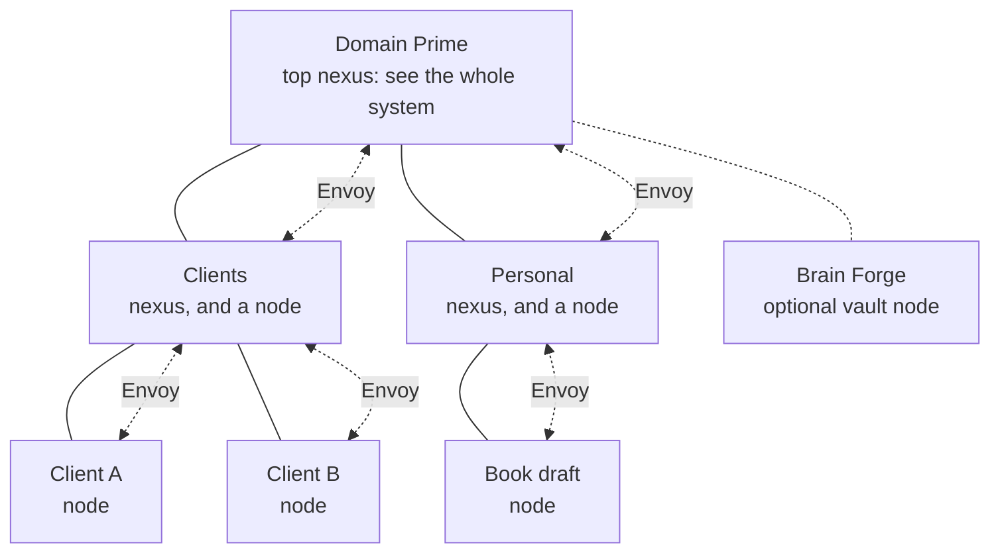

# Domain Prime family copy

The shared wording for the Domain Prime family: domainprime, insitu, envoy, context-forge, and brain-forge.
Every member README borrows from this file, so a change here is a change everywhere. Edit it here, then carry the change into each README.
The diagrams come from `tools/make_svgs.py`.

## The system in one paragraph

Domain Prime is a local-first way to run many projects with AI. It sets up a tree: one top folder, lines of work under it, projects under those. Every project is sovereign: its own rules, its own memory, its own walls. Insitu supplies each one with the instructions and skills it subscribes to from one shared vault. Context Forge remembers what happened in each project's sessions. Projects can't see into each other, so Envoy carries their messages up through each line of work and keeps one ranked board of priorities; stepping in at the top shows everything that needs you. Brain Forge, optional, is the long-term knowledge vault, graphed and indexed. Name the AI clients you use once, and every project adapts to each of them. The projects don't have to be code, or even AI work.

## First sentences

In every repo the README's first sentence is also the GitHub description. These are those sentences.

| Repo | First sentence |
|---|---|
| domainprime | Domain Prime organizes your AI projects as a tree: one install gives every project its own rules, its own memory, and a way to reach the others, in every AI client you use, all running on your machine. |
| insitu | Insitu keeps your AI instructions and skills in one vault, and every project subscribes to exactly the set it needs, so guidance stops drifting between projects. |
| envoy | Envoy carries messages between walled-off AI projects and keeps one ranked board of priorities, with a local dashboard of everything that needs you. |
| context-forge | Context Forge gives every AI project a local memory of its sessions, so the next session, in any AI client, picks up where the last one left off. |
| brain-forge | Brain Forge sets up a personal knowledge vault your agents maintain, from raw captures to a synthesized wiki and a link graph, while the contents stay yours. |

## The question each part answers

| Part | Question | Pitch |
|---|---|---|
| Domain Prime | Where does everything live? | Your AI projects as a tree, not a pile. |
| Insitu | How should I work here? | Write your instructions once. Every project subscribes to exactly the set it needs. |
| Context Forge | What happened last time? | Every session picks up where the last one left off, in any AI client. |
| Envoy | What matters most, and who needs to know? | Projects can't see into each other, so Envoy carries the messages between them and keeps one ranked board of priorities. Step in at the top to see everything that needs you. |
| Brain Forge | What do I know? | An optional knowledge vault your agents keep tidy: captured, synthesized, graphed. |

## System nod (engine READMEs)

Placed right after the problem and outcome sections, with the highlighted diagram.

> **Part of Domain Prime.** {Engine} is one of four engines in [Domain Prime](https://github.com/srmackey/domainprime), a local-first system for running many AI projects as a tree. {One sentence on this engine's role in the tree.} It also runs on its own: point it at any folder and it works without the rest.

Role sentences:

- Insitu: Every chair in the tree, the top included, can subscribe to its own set of instructions from one shared vault.
- Context Forge: Every chair keeps its own memory, stored inside its own line of work, and never searched from outside it.
- Envoy: Projects can't see into each other. Envoy carries their messages, always through a nexus, and keeps the ranked board.
- Brain Forge: The vault joins the tree as an optional node beside your lines of work.

## Use cases

| Use case | What the system does |
|---|---|
| A personal project with sensitive information | The project is marked sensitive in the registry, and its own constitution sets strict rules for what may be written. Its status reports say less on purpose. The dashboard hides its content until you choose to show it. Mail crossing its boundary stops at a gate where you deliver, hold, or discard it. Saving to the vault warns you and waits for confirmation. |
| Repos that share dev policies | Review, testing, and commit rules live once in Insitu, bundled as a role with their skills. Every repo subscribes to the role and adds its own extras. Change a policy once, rematerialize, and every repo is current. A shared rule can't be quietly edited from inside one project. |
| Stepping in from the top | When you step into a project from Domain Prime or any line of work, the agent loads that project's constitution and works under its rules. It announces the step-in, and the closest rule file wins. Across projects, the stricter privacy rule wins. Nothing it carried in gets filed there; findings for other projects leave as mail. |
| Seeing the whole system | Step in at the top and Envoy gives one view: every chair's health, what needs you, and one ranked priority board. |

Scenario characters for walkthroughs (fictional, per each repo's privacy rule):

- The consultant: a Clients line of work with Client A and Client B.
- The multi-repo developer: a Dev line of work with several repos sharing one role.
- The writer: a Personal line of work with a Book draft project.

## Principles

- **Local-first.** Everything runs on your machine. The servers talk to your AI client over stdio, make no network calls, and take no credentials.
- **Files are the record.** Markdown and YAML on disk. Indexes are derived and rebuildable.
- **Sovereign projects.** Each project's constitution stops at its edge. A nexus holds awareness, not work.
- **Your rules win where you step in.** Working inside a project means working under its rules.
- **Any AI client.** Name the clients you use; every project adapts to each one.
- **Each engine stands alone.** Install the whole tree, or use one engine in one folder.

## Mermaid fallback

For any place the SVG can't be used. GitHub renders this natively.

Every chair can subscribe to Insitu and keeps its own Context Forge memory.
